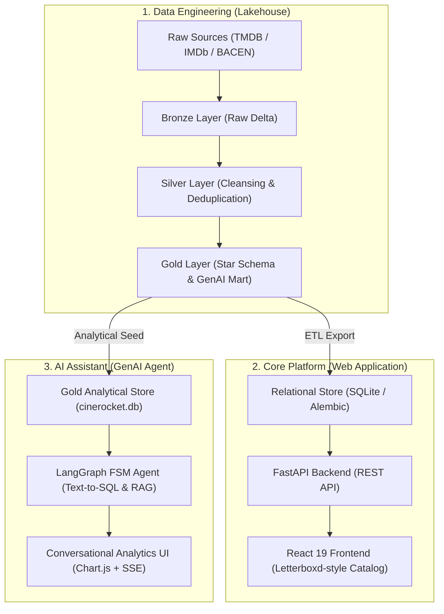
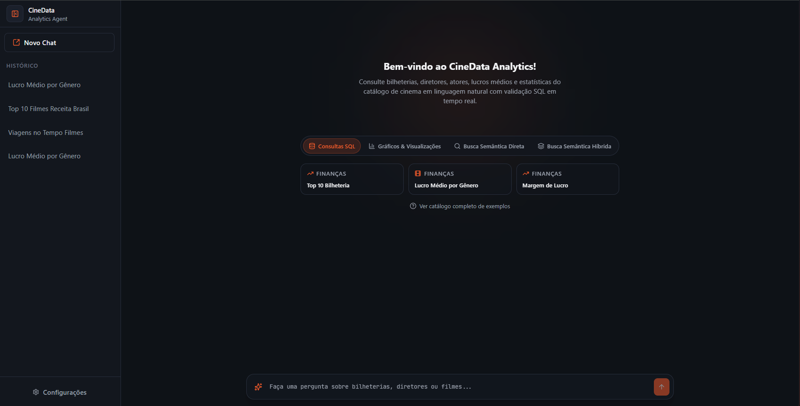
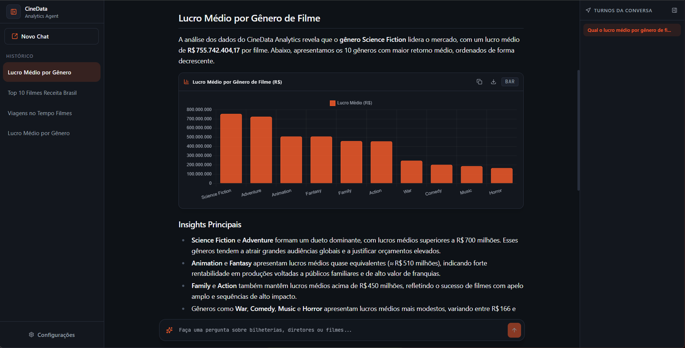

# CineRocket — Unified Cinema Analytics, Web Platform & GenAI Ecosystem

<div align="center">

[](https://www.python.org)
[](https://spark.apache.org/)
[](https://databricks.com)
[](https://fastapi.tiangolo.com)
[](https://react.dev)
[](https://www.typescriptlang.org)
[](https://langchain-ai.github.io/langgraph/)
[](https://tailwindcss.com)
[](https://bun.sh)
[](https://docs.astral.sh/uv/)

<p align="center">
  <b>An end-to-end cinematic data, application, and artificial intelligence platform.</b><br>
  Engineered from raw ingestion in a Medallion Lakehouse to an interactive consumer web experience and an autonomous conversational intelligence agent.
</p>

</div>

---

## 🏛️ Ecosystem Overview & Architecture

**CineRocket** demonstrates a production-grade software and data lifecycle divided into three specialized, loosely-coupled pillars:

1. **[Data Engineering (`data-pipeline/`)](./data-pipeline/README.md):** A Medallion Lakehouse pipeline on Databricks Serverless that ingests raw TMDB/IMDb datasets and BACEN currency rates, cleanses structural anomalies, models dimensional Star Schemas, and prepares multimodal GenAI context marts.
2. **[Core Platform (`core-platform/`)](./core-platform/README.md):** A Letterboxd-inspired fullstack movie portal built with FastAPI, React 19, TypeScript, TanStack Query, and Tailwind CSS v4, featuring a ⌘K Command Palette, personal watchlists, and an administrative title creation studio.
3. **[AI Assistant (`ai-assistant/`)](./ai-assistant/README.md):** An autonomous movie intelligence agent driven by a deterministic LangGraph Finite State Machine (FSM). It performs Zero-Shot Text-to-SQL, hybrid semantic search (RAG) over Portuguese reviews, and declarative data visualizations with Chart.js.



---

## 🧭 Repository Navigation

Each module is self-contained with its own tests, documentation, and dependencies:

| Module | Core Responsibility | Stack | Guide |
| :--- | :--- | :--- | :---: |
| **`data-pipeline/`** | Medallion Lakehouse, Data Cleaning & Star Schema | PySpark, Databricks Serverless, Delta Lake, AWS | [Explore](./data-pipeline/README.md) |
| **`core-platform/`** | Catalog Web App, Personal Watchlist & Title CRUD | FastAPI, React 19, TypeScript, Tailwind v4, Bun | [Explore](./core-platform/README.md) |
| **`ai-assistant/`** | Autonomous Agent, Text-to-SQL, RAG & Chart Gen | LangGraph, FastAPI, React 19, Chart.js, SQLite | [Explore](./ai-assistant/README.md) |

---

## 🎬 Module Highlights & Visual Showcase

### 1. Data Pipeline (`data-pipeline/`)
* **Medallion Architecture:** Raw ingest into Bronze $\rightarrow$ typing, currency forward-fill, and anomaly handling in Silver $\rightarrow$ Star Schema in Gold.
* **Real-World Anomaly Neutralization:** Resolved critical catalog duplications (e.g., deduplication by canonical work `tconst` instead of technical IDs, resolving artificial multi-appearance anomalies).
* **Databricks Workflows:** Serverless job orchestration with idempotency via `job.yaml` and operational deployment scripts.

<div align="center">
  
  
  <br>
  <sub><i>Left: Gold Dimensional Model (Star Schema). Right: Serverless Databricks Workflow execution.</i></sub>
</div>

👉 *Read full details: [Data Pipeline Documentation](./data-pipeline/README.md)*

---

### 2. Core Platform (`core-platform/`)
* **Vertical Slice Architecture:** Domain-driven feature organization separating business logic, API endpoints, and React components into vertical slices.
* **Command Palette (⌘K / Ctrl+K):** Real-time debounced global search navigating both titles and filmmakers with full keyboard navigation.
* **Movie Creation Studio:** Live 2:3 poster rendering with async URL validation and automatic local draft recovery (`• Draft Saved`).

<div align="center">
  
  
  <br>
  <sub><i>Left: Fluid catalog browsing & layout toggle. Right: Cinematic poster grid (2:3 aspect ratio).</i></sub>
</div>

👉 *Read full details: [Core Platform Documentation](./core-platform/README.md)*

---

### 3. AI Assistant (`ai-assistant/`)
* **Deterministic FSM (LangGraph):** Predictable state machine routing between Direct Response, Text-to-SQL, Semantic Vector Search (RAG), and Hybrid Search.
* **Security & Self-Healing:** Strict SQL AST validation enforcing a read-only sandbox, paired with an automated retry loop resolving syntax errors in up to 3 iterations.
* **Multimodal Generation:** Dynamic **Chart.js** charts (bar, line, donut, pie) and interactive tables with CSV/JSON export.

<div align="center">
  
  
  <br>
  <sub><i>Left: Conversational UI with streaming thoughts and steps. Right: Dynamic Chart.js financial visualizer.</i></sub>
</div>

👉 *Read full details: [AI Assistant Documentation](./ai-assistant/README.md)*

---

## ⚡ Quickstart & Monorepo Orchestration

This monorepo provides a root `Makefile` that delegates setup and execution commands cleanly across all modules without cluttering your environment:

### 1. Initial Setup
```bash
# Set up Python (uv) and Node (bun) environments across all three modules
make setup-all
```
*(Or set up individually with `make setup-data`, `make setup-core`, or `make setup-ai`).*

### 2. Launching Services
```bash
# Launch the Core Platform (FastAPI Backend + React 19 Frontend)
make run-core

# Launch the GenAI Movie Agent (FastAPI Backend + React 19 Analytics Frontend)
make run-ai
```

### 3. Running Automated Tests & Quality Checks
```bash
# Run pytest (backend) and vitest (frontend) suites across the repository
make test-all

# Run code formatters and linters (Ruff for Python, ESLint for TypeScript)
make lint-all
```

---

## 🛠️ Complete Technology Matrix

| Domain | Technologies & Libraries |
| :--- | :--- |
| **Data Engineering** | Apache Spark, PySpark, Databricks Serverless Workflows, Delta Lake, AWS, BACEN PTAX API |
| **Backend Services** | Python 3.11/3.12, FastAPI, SQLAlchemy 2.0, Alembic, Pydantic v2, SQLite, Uvicorn, uv |
| **Frontend Applications** | React 19, TypeScript 5.9, Vite 8, Bun, Tailwind CSS v4, shadcn/ui, TanStack Query v5 |
| **GenAI & Intelligence** | LangGraph, LangChain, SQLite-Vec, Sentence Transformers, Chart.js, Server-Sent Events |
| **Testing & Quality** | Pytest, Vitest, Testing Library, Ruff, ESLint, Fallow, Biome |

---

## 📄 License
This repository is published for portfolio and technical demonstration purposes under the [MIT License](LICENSE).
