# CineRocket — GenAI Movie Intelligence Agent

[](https://python.org)
[](https://fastapi.tiangolo.com)
[](https://langchain-ai.github.io/langgraph/)
[](https://sqlite.org)
[](https://react.dev)
[](https://www.typescriptlang.org)
[](https://tailwindcss.com)
[](https://www.chartjs.org/)
[](https://docs.astral.sh/uv/)
[](https://bun.sh)

> **Part of the [CineRocket Platform](../README.md) Ecosystem**  
> An autonomous Generative AI analytical agent orchestrated with a deterministic LangGraph Finite State Machine (FSM). Designed to bridge business decision-makers and the Gold Lakehouse layer via Text-to-SQL, hybrid semantic search (RAG), and dynamic Chart.js visualizations.

---

## 📑 Table of Contents

- [📸 Interface Showcase](#interface-showcase)
- [🤖 Model Inference Setup (LLM Options)](#model-inference-setup-llm-options)
  - [Option 1: Local Execution with Qwen3-4B Llamafile (Zero Setup)](#option-1-local-execution-with-qwen3-4b-llamafile-recommended-offline)
  - [Option 2: Local Execution with Ollama via Docker](#option-2-local-execution-with-ollama-via-docker)
  - [Option 3: Cloud Providers (Groq, Google Gemini, OpenRouter)](#option-3-cloud-providers-groq-google-gemini-openrouter)
- [🏛️ Architectural Overview](#architectural-overview)
- [🔄 Finite State Machine (LangGraph FSM)](#finite-state-machine-langgraph-fsm)
- [🎯 Analytical & Semantic Question Capabilities](#analytical--semantic-question-capabilities)
  - [1. Relational Analytics (Text-to-SQL)](#1-relational-analytics-text-to-sql)
  - [2. Declarative Visualizations & Charts](#2-declarative-visualizations--charts)
  - [3. Direct Semantic Search (Qualitative RAG)](#3-direct-semantic-search-qualitative-rag)
  - [4. Hybrid Semantic Search (Vector + Relational SQL)](#4-hybrid-semantic-search-vector--relational-sql)
- [🚀 System Capabilities & Key Highlights](#system-capabilities--key-highlights)
- [🗄️ Lakehouse Gold Layer Schema](#lakehouse-gold-layer-schema)
- [🛠️ Quickstart & Execution Guide](#quickstart--execution-guide)
  - [1. Configure Environment Variables](#1-configure-environment-variables)
  - [2. One-Command Automated Setup](#2-one-command-automated-setup)
  - [3. Manual Setup Step-by-Step](#3-manual-setup-step-by-step)

---

<a id="interface-showcase"></a>
## 📸 Interface Showcase

### System Overview & Streaming Chat

<sub>*Modern analytical conversational UI with Server-Sent Events (SSE) streaming and persistent session history.*</sub>

---

### Multi-Provider LLM Configuration
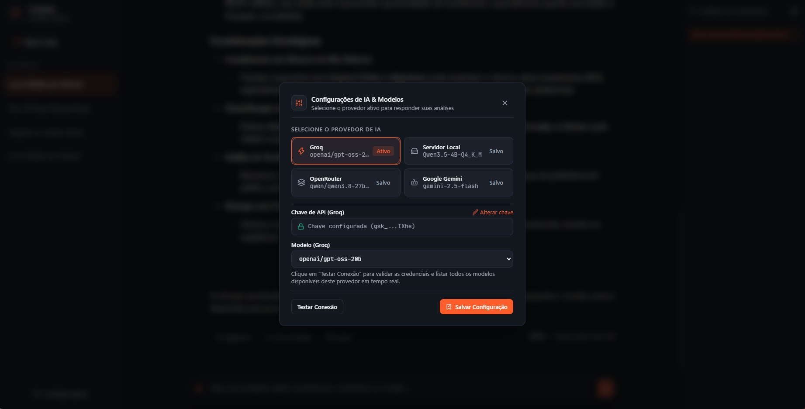
<sub>*Dynamic provider switching: OpenRouter, LM Studio, Ollama, Groq, Google Gemini, and local Llamafile/llama.cpp.*</sub>

---

### Bar Charts (Chart.js)

<sub>*Automated declarative generation of financial metrics and comparative performance.*</sub>

---

### Time-Series Line Charts
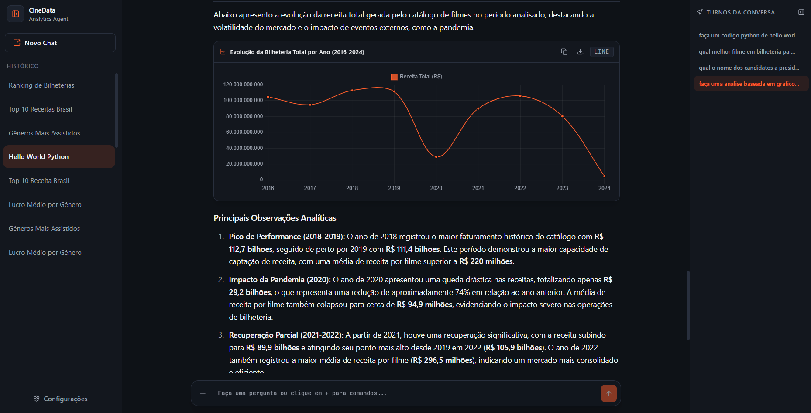
<sub>*Historical trends and evolution over time with automatic axis configuration.*</sub>

---

### Donut & Proportional Visualizations
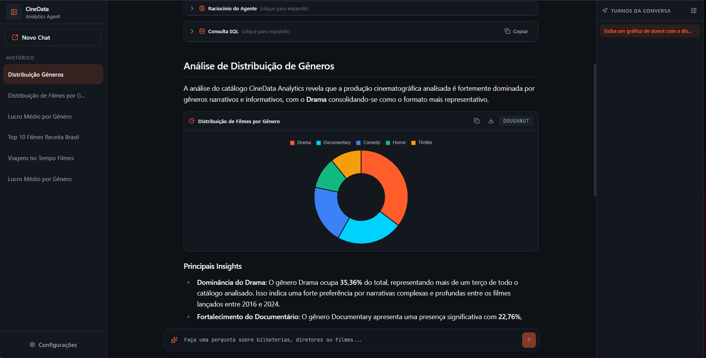
<sub>*Interactive category distribution and catalog segmentation.*</sub>

---

### Pie Charts & Composition
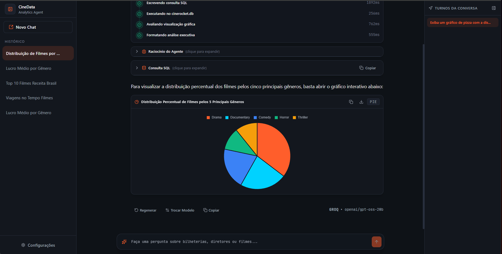
<sub>*Genre distributions and production status breakdowns.*</sub>

---

### Interactive Tables with Sorting & Export
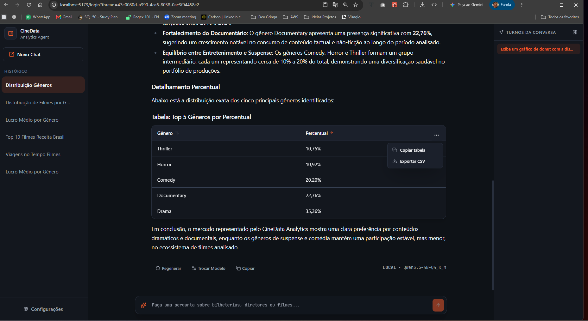
<sub>*Tabular response rendering with column sorting and 1-click CSV/JSON export.*</sub>

---

### Transparent Reasoning, Steps & Executed SQL
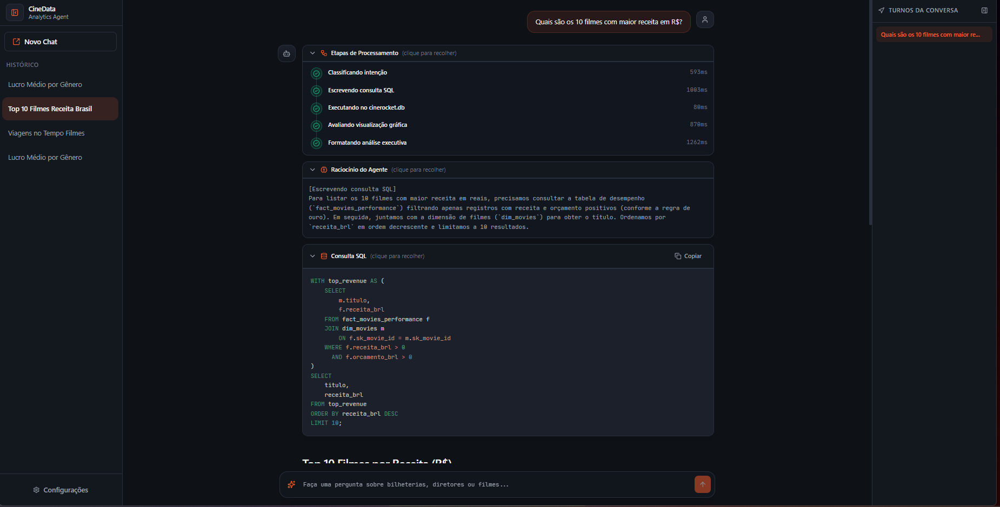
<sub>*Auditability and explainability: inspect AST-validated SQL, execution steps, and thoughts.*</sub>

---

### Guided Prompts & Quick Actions
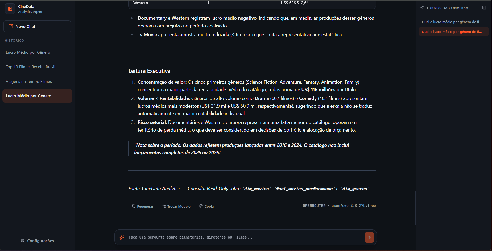
<sub>*Categorized prompt recommendations, copy response, and regeneration actions.*</sub>

---

### Fast Keyboard Slash Commands
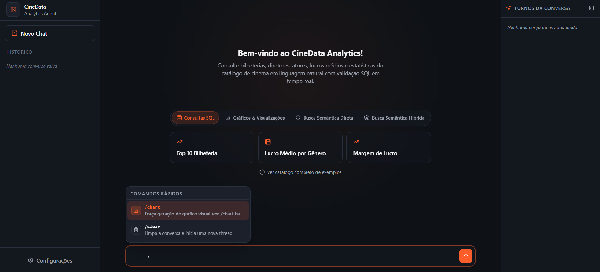
<sub>*Floating command palette (`/chart`, `/clear`) with keyboard navigation.*</sub>

---

### Contextual Movie Entity Hover Preview
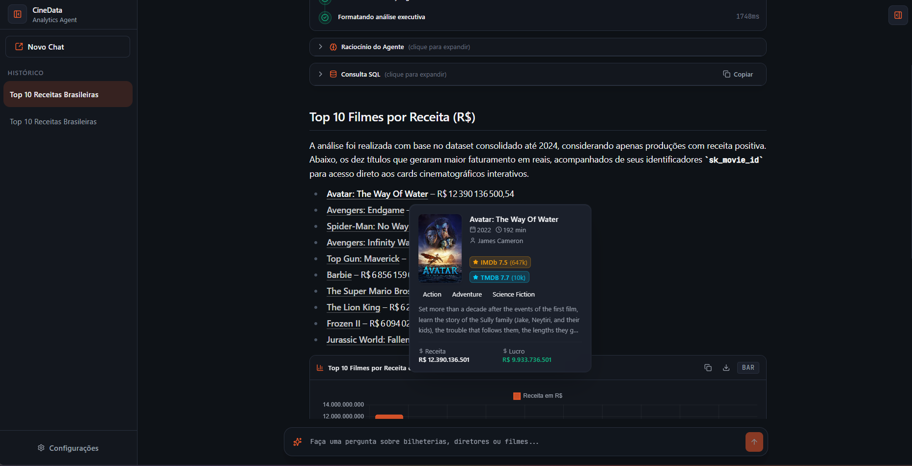
<sub>*Intelligent entity detection: hovering over any recognized movie title displays a rich contextual preview card with poster, rating, synopsis, and metadata.*</sub>

---

### Graceful Fallback & Error Handling
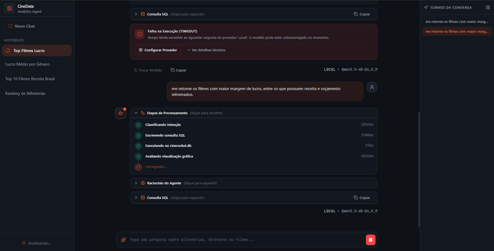
<sub>*Fault tolerance: graceful detection of model timeouts or quota exhaustion with immediate reconfiguration dialogs without losing conversation context.*</sub>

---

<a id="model-inference-setup-llm-options"></a>
## 🤖 Model Inference Setup (LLM Options)

**CineRocket AI** is 100% provider-agnostic. You can run inference locally on your machine for complete privacy and zero API costs, or connect cloud providers via API keys.

<p align="center">
  
  <br>
  <sub><b>100% Configurable via UI:</b> Open settings in the top bar, select your provider, enter the API key or endpoint, and verify connection in 1 click. API keys saved through the UI are <b>reversibly encrypted with Fernet (AES-128-CBC)</b> in the internal SQLite settings database (<code>app_settings.db</code>). Alternatively, configure values via <code>.env</code>.</sub>
</p>

### Integration Options Overview

1. **Local Llamafile (Zero Setup):** A single self-contained executable that runs locally without Python/C++ compilation.
2. **Ollama via Docker:** Standardized containerized runtime with GPU or CPU acceleration.
3. **Cloud Providers (Groq, Google Gemini, OpenRouter):** Sub-second responses without local RAM/VRAM consumption.

> [!TIP]
> **Recommended Minimum Model Size:** We recommend models with at least **4 billion parameters (4B)** — such as **Qwen 2.5 7B** or **Llama 3.3 70B**. Smaller models (< 3B) often struggle with relational logic and SQL AST constraints.

---

<a id="option-1-local-execution-with-qwen3-4b-llamafile-recommended-offline"></a>
### Option 1: Local Execution with Qwen3-4B Llamafile (Recommended Offline)

The [Mozilla AI Qwen3-4B-llamafile](https://huggingface.co/mozilla-ai/Qwen3-4B-llamafile) bundles the model and inference runtime into a cross-platform executable.

#### On Linux / WSL
```bash
curl -L -o Qwen3-4B.llamafile https://huggingface.co/mozilla-ai/Qwen3-4B-llamafile/resolve/main/Qwen3-4B.llamafile
chmod +x Qwen3-4B.llamafile
./Qwen3-4B.llamafile --nobrowser --port 8080
```

#### On Windows Native
1. Download `Qwen3-4B.llamafile` directly from Hugging Face.
2. Rename the file to `Qwen3-4B.llamafile.exe`.
3. Run `.\Qwen3-4B.llamafile.exe --nobrowser --port 8080` in PowerShell.

---

<a id="option-2-local-execution-with-ollama-via-docker"></a>
### Option 2: Local Execution with Ollama via Docker

```bash
# CPU mode:
docker run -d -v ollama_models:/root/.ollama -p 11434:11434 --name cinedata-ollama ollama/ollama

# Pull an analytical model:
docker exec -it cinedata-ollama ollama run qwen2.5:7b
```

---

<a id="option-3-cloud-providers-groq-google-gemini-openrouter"></a>
### Option 3: Cloud Providers (Groq, Google Gemini, OpenRouter)

* ⚡ **[Groq Cloud](https://console.groq.com/keys):** Ultra-fast LPU inference supporting `llama-3.3-70b-versatile`. (`GROQ_API_KEY=gsk_...`)
* 🌐 **[OpenRouter](https://openrouter.ai/settings/keys):** Access hundreds of models including `:free` endpoints. (`OPENROUTER_API_KEY=sk-or-v1-...`)
* ♊ **[Google AI Studio](https://aistudio.google.com/app/apikey):** Advanced Gemini reasoning models like `gemini-2.5-flash`. (`GEMINI_API_KEY=AIzaSy...`)

---

<a id="architectural-overview"></a>
## 🏛️ Architectural Overview

The agent acts as an analytical bridge between business decision-makers and the Lakehouse Gold layer (`cinerocket.db`).

Rather than relying on repetitive tool-calling that inflates latency and token usage, the agent operates over a **Finite State Machine (FSM)** orchestrated with **LangGraph**:
1. **Embedded Compact Semantic Catalog** (~600 tokens) for *Zero-Shot* SQL generation.
2. **Strict AST Validation & Read-Only Sandbox** preventing destructive DDL/DML.
3. **Self-Healing SQL Loop** with automatic syntax and runtime correction up to 3 attempts.
4. **Hybrid Vector Engine** with multilingual embeddings (`sentence-transformers/paraphrase-multilingual-MiniLM-L12-v2`) over synopses and reviews.
5. **Real-Time Streaming (SSE)** with decoupled rendering of text, tables, and **Chart.js** configurations.

---

<a id="finite-state-machine-langgraph-fsm"></a>
## 🔄 Finite State Machine (LangGraph FSM)

The agent workflow is structured as a deterministic state graph:

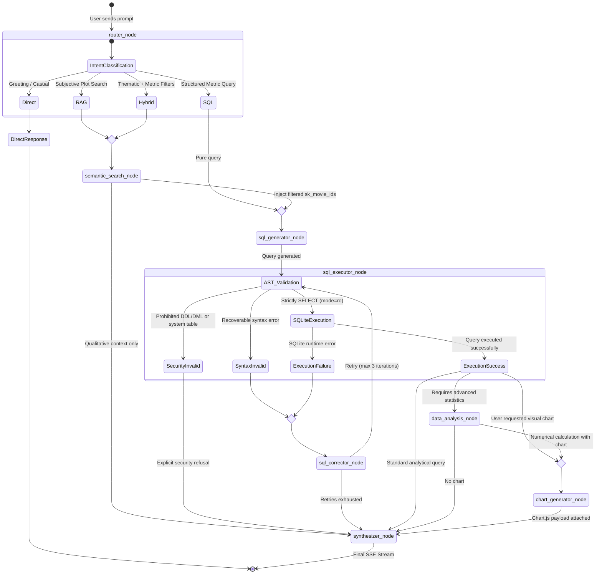

### Graph Nodes Breakdown

| Graph Node | Technical Role | Transition Behavior |
| :--- | :--- | :--- |
| **`router_node`** | Classifies user intent. | Routes to RAG, Hybrid, Pure SQL, or Direct Response. |
| **`semantic_search_node`** | Cosine similarity k-NN search over synopses & reviews. | For pure RAG, routes to synthesizer; for Hybrid, forwards candidate IDs to SQL generator. |
| **`sql_generator_node`** | Generates SQL using the compact catalog. | Enforces safety constraints and forwards query to AST validation. |
| **`sql_executor_node`** | Validates AST (blocks writes) and executes against SQLite in `mode=ro`. | Triggers corrector on syntax error; routes to analysis/chart on success. |
| **`sql_corrector_node`** | Evaluates runtime tracebacks and refines query. | Self-healing loop (up to 3 tries); immediately rejects security violations. |
| **`data_analysis_node`** | Computes descriptive statistics and correlations. | Forwards processed results to chart generator or synthesizer. |
| **`chart_generator_node`** | Produces declarative `ChartJsConfigDTO` specifications. | Attaches visual configuration for instant frontend rendering. |
| **`synthesizer_node`** | Consolidates executive markdown response with tables and insights. | Streams response blocks to user via Server-Sent Events (SSE). |

---

<a id="analytical--semantic-question-capabilities"></a>
## 🎯 Analytical & Semantic Question Capabilities

<a id="1-relational-analytics-text-to-sql"></a>
### 1. Relational Analytics (Text-to-SQL)
* **Top 10 Box Office:** *"What are the top 10 movies by total revenue in BRL?"*
* **Average Profit by Genre:** *"What is the average profit per movie genre?"*
* **Maximum Profit Margin:** *"Which films achieved the highest percentage profit margins?"*
* **TMDB Popularity:** *"What are the 5 most popular movies according to TMDB?"*
* **Critics vs. Audience Divergence:** *"Which movies exhibit the largest gap between TMDB and IMDb scores?"*
* **Historical Rating Evolution:** *"What is the average IMDb rating of movies by release year?"*
* **Most Active Actors:** *"Which actor appeared in the most movies over the last 5 years?"*
* **Consistently Top Directors:** *"Which directors hold the highest average score with at least 5 movies directed?"*
* **Studio Profitability:** *"Which studio accumulated the highest total box office profit?"*

<a id="2-declarative-visualizations--charts"></a>
### 2. Declarative Visualizations & Charts
* **Financial Bar Chart:** *"Generate a bar chart showing the 5 most profitable production companies."*
* **Pie/Donut Breakdown:** *"Display a pie chart with the percentage distribution of films across the top 5 genres."*
* **Rating Time Series:** *"Plot the evolution of average IMDb movie ratings over the decades."*
* **Sector Comparison:** *"Show a revenue comparison chart for the top 5 Sci-Fi films."*

<a id="3-direct-semantic-search-qualitative-rag"></a>
### 3. Direct Semantic Search (Qualitative RAG)
* **Sci-Fi Tropes:** *"Find movies dealing with time travel or parallel dimensions."*
* **Sentiment in Reviews:** *"Look for user reviews praising an unexpected plot twist."*
* **Contemporary Themes:** *"Identify films focused on artificial intelligence or cyborgs."*
* **Overcoming Adversity:** *"Search for films about overcoming grief or extreme sports challenges."*

<a id="4-hybrid-semantic-search-vector--relational-sql"></a>
### 4. Hybrid Semantic Search (Vector + Relational SQL)
* **Sci-Fi Financials:** *"Find movies about time travel and show the budget and IMDb rating of each."*
* **Plot Twist & Box Office:** *"Find films praised for their plot twists that grossed over $100M."*
* **High-Rated Dramas:** *"Search for films about overcoming family loss with user ratings above 8.0."*

---

<a id="system-capabilities--key-highlights"></a>
## 🚀 System Capabilities & Key Highlights

- 🛡️ **Zero Vulnerability & Read-Only Governance:** AST validation blocks `DROP`, `DELETE`, `UPDATE`, or system schema access. SQLite runs strictly in `mode=ro`.
- 🔁 **Self-Healing SQL Loop:** Automated correction loop resolving syntax errors in up to 3 iterations.
- ⚡ **Resilience & In-Flight Model Switching:** Seamless timeout recovery with quick reconfiguration modal preserving chat history.
- 🌐 **Provider Agnostic:** Plug-and-play support for **OpenRouter**, **Groq**, **Google Gemini**, **LM Studio**, **Ollama**, and **Llamafile**.
- 📊 **Multimodal Output:** Dynamic **Chart.js** visualizations and interactive tables with client-side export.
- 🔍 **Hybrid Multilingual RAG:** Embeddings over Portuguese synopses and user reviews.
- 🎬 **Contextual Hover Previews:** Real-time entity extraction generating hover cards with posters and metrics.
- ⌨️ **Slash Commands:** Keyboard-driven popover menu (`/chart`, `/clear`).
- 🌊 **Streaming SSE with Thought Traces:** Real-time feedback displaying reasoning steps and executed queries.

---

<a id="lakehouse-gold-layer-schema"></a>
## 🗄️ Lakehouse Gold Layer Schema

The agent operates against the dimensional SQLite database (`cinerocket.db`):

```
cinerocket.db (Star Schema)
│
├── fact_movies_performance (Fact: budget, revenue, profit, ratings, popularity)
│
├── dim_movies             (Dimension: title, overview, year, runtime, status)
├── dim_people             (Dimension: actors, directors, writers)
├── dim_genres             (Dimension: canonical genres)
├── dim_companies          (Dimension: production companies & studios)
├── dim_reviews            (Dimension: consolidated review metrics)
├── movie_reviews          (Fact/Text: Portuguese reviews for semantic RAG)
│
└── Bridge Tables (N:N)
    ├── bridge_movie_person
    ├── bridge_movie_genre
    └── bridge_movie_company
```

---

<a id="quickstart--execution-guide"></a>
## 🛠️ Quickstart & Execution Guide

### Prerequisites
* **Python 3.12+** managed with **`uv`** (recommended) or standard `python3-venv`.
* **Node.js** with **`bun`** (recommended) or `npm`.

<a id="1-configure-environment-variables"></a>
### 1. Configure Environment Variables
```bash
cp .env.example .env
```
*(Configure API keys in `.env` or set them up directly inside the web UI).*

---

<a id="2-one-command-automated-setup"></a>
### 2. One-Command Automated Setup

The project includes smart setup scripts that auto-detect runtimes (**`uv`** / **`pip`**, **`bun`** / **`npm`**), unpack the database if needed, configure environments, and boot both servers concurrently:

#### 🐧 Linux / macOS / WSL
```bash
chmod +x setup.sh
./setup.sh
```

#### 🪟 Windows (PowerShell)
```powershell
.\setup.ps1
```

---

<a id="3-manual-setup-step-by-step"></a>
### 3. Manual Setup Step-by-Step

#### Step A: Unpack Database (`cinerocket.db`)
If starting from compressed `database.sql.xz` or `database_dump.sql`:
```bash
# Via Linux xz / sqlite3:
xz -dc database.sql.xz | sqlite3 cinerocket.db

# Or via Python (cross-platform):
python3 -c "import sqlite3, lzma; conn = sqlite3.connect('cinerocket.db'); conn.executescript(lzma.open('database.sql.xz', 'rt', encoding='utf-8').read()); conn.close()"
```

#### Step B: Start Backend
```bash
cd backend
uv sync --all-extras
uv run uvicorn app.main:app --host 0.0.0.0 --port 8000 --reload
```

#### Step C: Start Frontend
```bash
cd frontend
bun install
bun run dev
```

* **Web UI:** `http://localhost:5173`
* **Interactive API Docs:** `http://localhost:8000/docs`
