# CineFlow — Cinematic Catalog & Analytical Web Platform

<div align="center">

[](https://fastapi.tiangolo.com)
[](https://www.python.org)
[](https://react.dev)
[](https://www.typescriptlang.org)
[](https://vitejs.dev)
[](https://tailwindcss.com)
[](https://ui.shadcn.com)
[](https://tanstack.com/query)
[](https://sqlite.org)
[](https://docs.astral.sh/uv/)
[](https://bun.sh)

> **Part of the [CineRocket Platform](../README.md) Ecosystem**  
> A Letterboxd-inspired fullstack movie platform combining high-performance analytical browsing, editorial details, community reviews, personal libraries, and an administrative studio for title management.

</div>

---

## 📑 Table of Contents

- [🎬 Showcase & Application Media](#-showcase--application-media)
  - [🎥 Video Demonstrations & Animations](#-video-demonstrations--animations)
  - [📸 Screenshots & Key Flows](#-screenshots--key-flows)
- [🎯 User Stories & Key Features](#-user-stories--key-features)
- [🚀 Quickstart & Execution Guide](#-quickstart--execution-guide)
  - [1. Prerequisites & Required Data (CSV)](#1-prerequisites--required-data-csv)
  - [2. One-Command Automated Setup](#2-one-command-automated-setup-recommended)
  - [3. Manual Setup Step-by-Step](#3-manual-setup-step-by-step-optional)
  - [4. Automated Testing & Code Quality](#4-automated-testing--code-quality)
- [🏛️ Vertical Slice Architecture](#️-vertical-slice-architecture)
- [📖 Detailed Documentation](#-detailed-documentation)

---

## 🎬 Showcase & Application Media

### 🎥 Video Demonstrations & Animations

#### 1. Catalog Browsing & Fluid Layout Switching
Demonstration of seamless catalog navigation, switching effortlessly between Movie Poster Grid and Analytical List views, combining multi-genre filters, and instant client-side pagination.

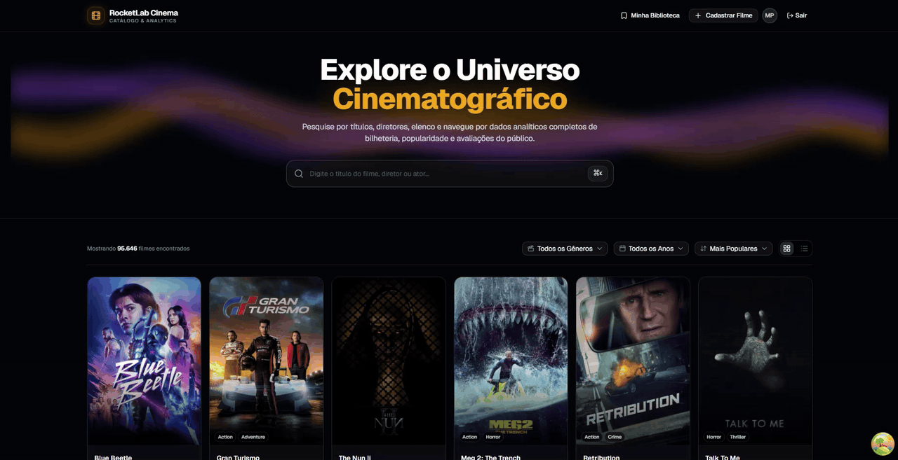

---

#### 2. Quick Actions: Context Menu, Reviews, Favorites & Watchlist
Direct context actions on movies: right-click context menu, instant addition to Favorites and Watchlist via optimistic updates, and immediate review dialog trigger.

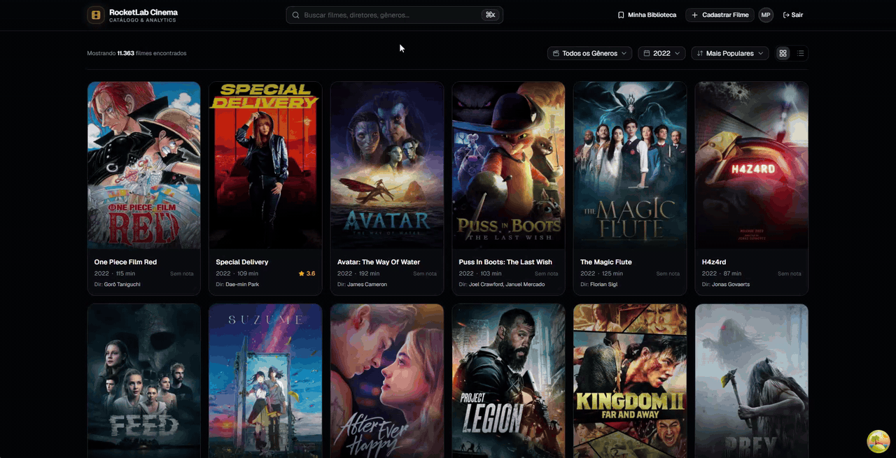

---

#### 3. Command Palette (⌘K / Ctrl+K) — Global Search & Fast Navigation
Universal keyboard shortcut accessing any movie, industry personality (actors, directors, writers), or system page. Features debounced real-time search, categorization, and complete keyboard navigation.

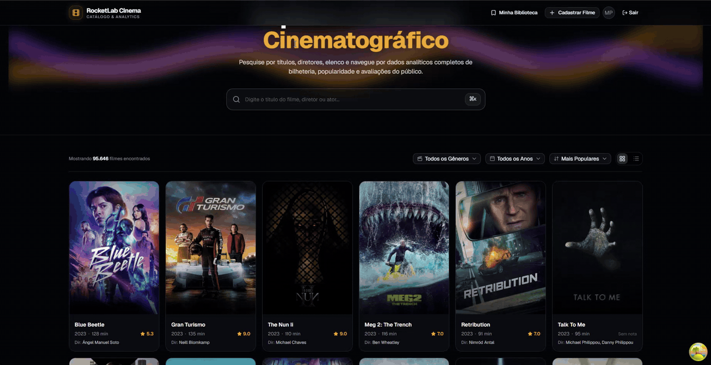

---

#### 4. Administrative Authentication & Login Microinteractions
Admin portal authentication with credential validation, secure JWT generation, smooth input interactions, and a 1-click credential auto-filler for testing.


---

### 📸 Screenshots & Key Flows

#### 1. Cinematic Poster Grid (2:3 Aspect Ratio)
Immersive movie catalog rendering high-resolution posters in standard 2:3 ratio, with hover action pills (Favorite, Watchlist, Rate), efficient pagination, and genre/year filters.

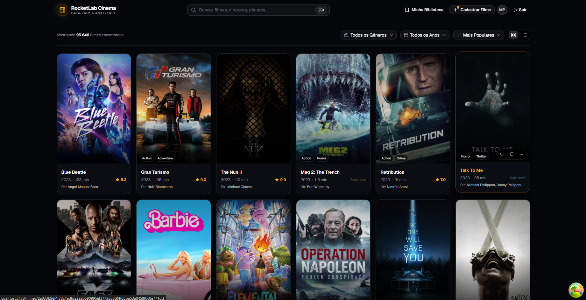

---

#### 2. Analytical List View
Tabular view displaying financial metrics, popularity, ratings comparisons, and comprehensive metadata in a responsive layout.

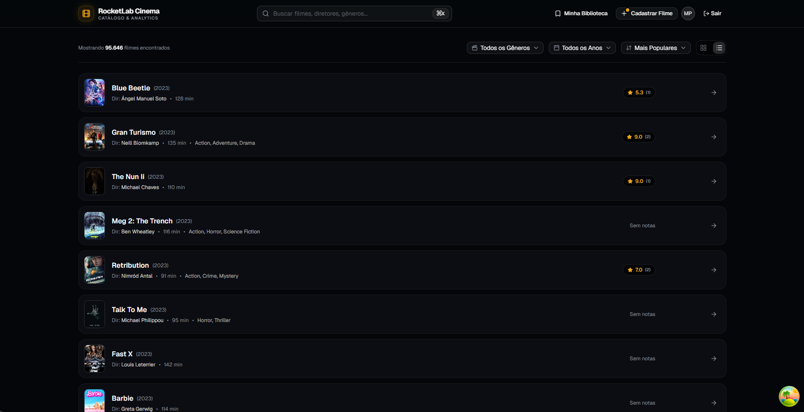

---

#### 3. Editorial Movie Page & Panoramic Backdrop
Detailed title page with high-definition backdrop, full synopsis, cast & crew breakdown, comparative financial metrics (USD/BRL), and unified ratings (CineFlow, TMDb, and IMDb).

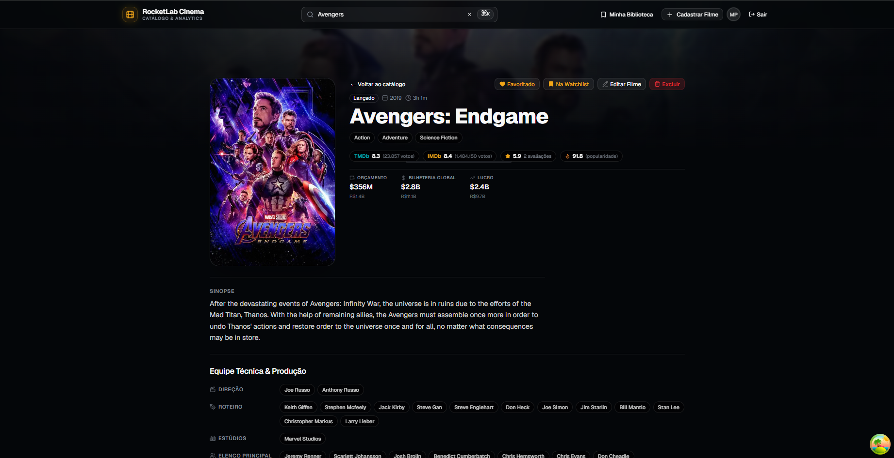

---

#### 4. Community Reviews & Rating Submission
Intuitive modal to submit ratings (0-10) and written reviews, triggering an atomic recalculated community average and immediate display in the review feed.

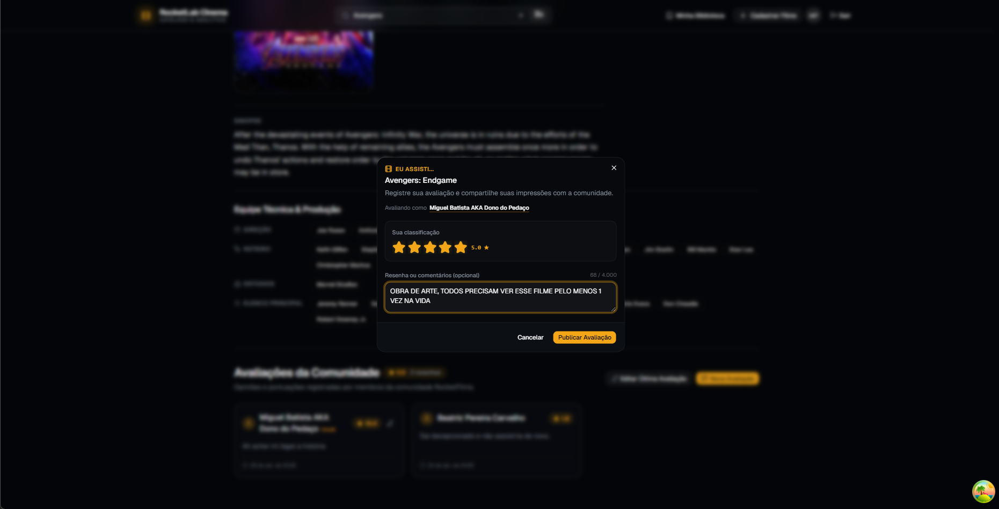

---

#### 5. Movie Creation Studio (Live Poster Preview & Auto-Save)
Advanced admin title creation form with asynchronous image URL validation (`✓ Image verified and accessible`), live 2:3 poster rendering, and automatic local draft saving (`• Draft Saved`) preventing accidental data loss.

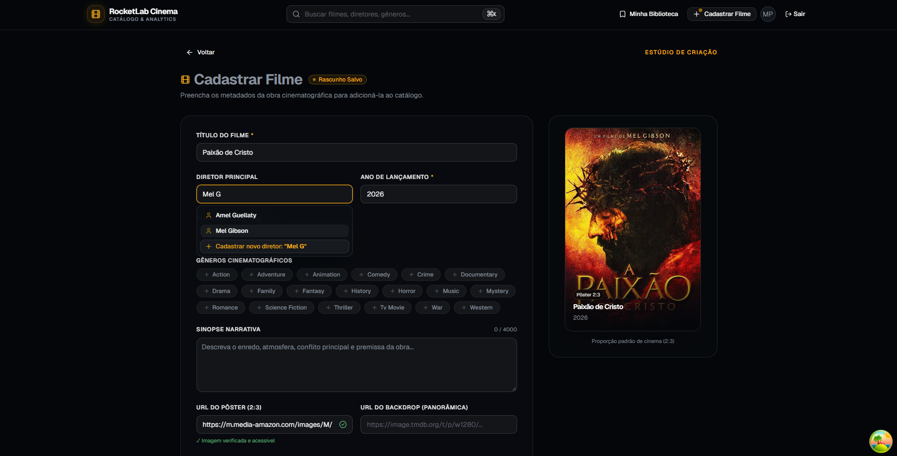

---

#### 6. Metadata Management & Title Editing
Admin editing panel for metadata updates, dynamic director selection with intelligent search, and controlled destructive title deletion with confirmation dialogs.

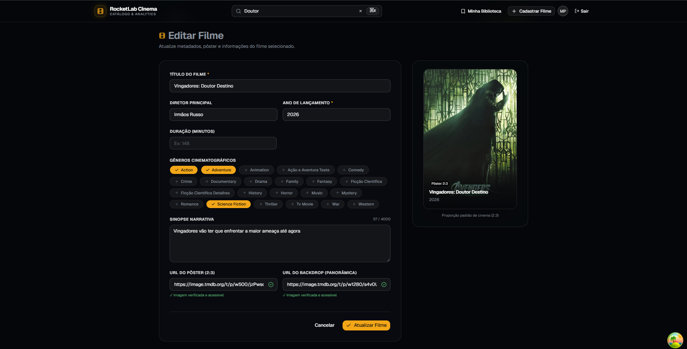

---

#### 7. Personal Library (Favorites & Watchlist)
Personal user hub with dedicated tabs for Favorites and Watchlist, synchronized instantly with optimistic updates.

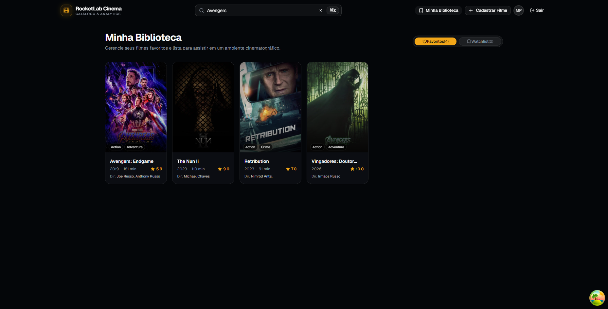

---

#### 8. Global Person & Filmmaker Search (Command Palette)
Integrated `⌘K` / `Ctrl+K` palette locating both titles and filmmakers (actors, directors, writers), displaying credit counts and quick direct links to artist profiles.

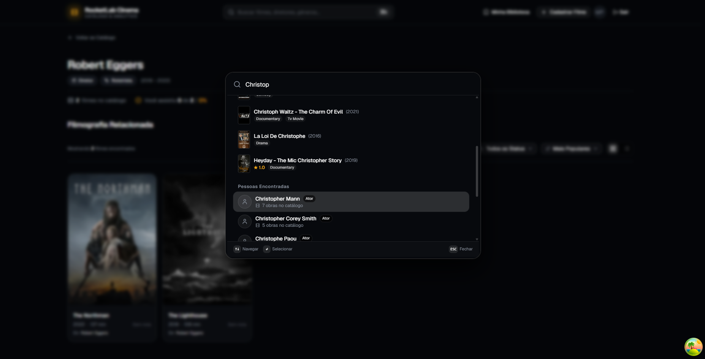

---

#### 9. Artist Profile & Complete Filmography
Dedicated artist view (`/pessoas/:id`) displaying consolidated career metrics (active period, average score, roles, total works), a gamified movie progress indicator, and integrated genre/year filters.

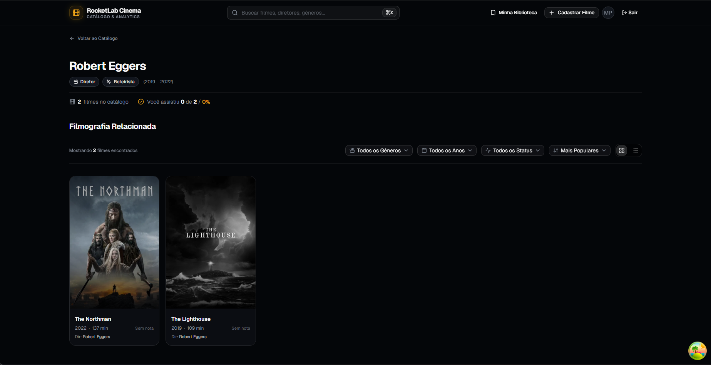

---

## 🎯 User Stories & Key Features

- **Paginated Catalog Navigation:**
  - Instant toggle between **Grid (2:3 Cards)** and **Analytical List** views.
  - Dynamic filters for **Genre** and **Release Year** populated straight from the database.
  - Multi-criteria sorting: Popularity, User Rating, Box Office (USD), Release Year, and Title.
- **Global Instant Search:**
  - In-page search bar and **Command Palette (`⌘K` / `Ctrl+K`)** for real-time debounced search across **both movies and people**.
- **Person Profiles & Filmography:**
  - Dedicated pages (`/pessoas/:id`) for artists with career insights, roles, and movie lists.
  - User progress indicator showing percentage of movies watched by the logged-in user.
- **Technical Sheet & Analytical Comparisons:**
  - Complete work details (synopsis, runtime, director, writers, studios, primary cast).
  - **Rating Comparison:** Internal CineFlow rating vs. TMDb vs. IMDb.
  - **Financial Dashboard:** Budget, worldwide box office, ROI (USD/BRL), and popularity index.
  - High-definition poster lightbox.
- **Community & Reviews:**
  - Review submissions with ratings from **0 to 10** and markdown text.
  - Transactional, atomic recalculation of movie average ratings and counts.
- **Personal Library (My List):**
  - Save to **Favorites** and **Watchlist** in 1 click with **Optimistic Updates**.
  - Unified `/minha-lista` page to manage saved titles.
- **Catalog Administration (Full CRUD & Creation Studio):**
  - Secure authentication with JWT tokens (`admin@rocketfilms.com` / `admin123`).
  - **Auto-Save Draft Recovery:** Form progress automatically persisted in `localStorage`.
  - **Active Image Validation & Live Poster Preview:** Validates image accessibility prior to submission.
  - **Director Combobox with Dynamic Creation:** Search existing directors or create new ones on the fly.
  - **Safe Deletion:** Confirmation dialogs and cascading relationship cleanup.

---

## 🚀 Quickstart & Execution Guide

### 1. Prerequisites & Required Data (CSV)

The project leverages [**uv**](https://docs.astral.sh/uv/) and [**Bun**](https://bun.sh/) for maximum developer performance. However, automated fallback support to standard **Python 3.11+ (`venv` / `pip`)** and **Node.js (`npm`)** is built-in.

> **Required CSV Data Files:**  
> The seed pipeline expects the dimensional CSV files in `../data/gold/`:
> `dim_movies.csv`, `dim_genres.csv`, `dim_companies.csv`, `dim_people.csv`, `bridge_movie_genre.csv`, `bridge_movie_company.csv`, `bridge_movie_person.csv`, `fact_movies_performance.csv`, `dim_reviews.csv`, `movies_reviews.csv`.

---

### 2. One-Command Automated Setup (Recommended)

Run the automated orchestrator to verify requirements, apply migrations, seed the database if needed, and start both backend (FastAPI) and frontend (Vite) concurrently:

#### 🐧 Linux / macOS / Git Bash / WSL
```bash
./setup.sh
```

#### 🪟 Windows (PowerShell)
```powershell
.\setup.ps1
```

---

### 3. Manual Setup Step-by-Step (Optional)

#### Backend (FastAPI + SQLite + Alembic)
```bash
cd backend

# 1. Environment configuration
cp .env.example .env

# 2. Sync dependencies
uv sync --all-extras

# 3. Apply database migrations
uv run alembic upgrade head

# 4. Seed database from CSV files
uv run python scripts/seed_database.py

# 5. Start development server
uv run uvicorn app.main:app --reload --port 8000
```

- **REST API:** `http://localhost:8000`
- **Interactive Documentation (Swagger):** `http://localhost:8000/docs`
- **Health Check:** `http://localhost:8000/health`

---

#### Frontend (Vite + React 19 + Bun)
```bash
cd frontend

# 1. Install dependencies
bun install

# 2. Start development server
bun run dev
```

- **Web Application:** `http://localhost:5173`

#### Default Admin Credentials
- **Email:** `admin@rocketfilms.com`
- **Password:** `admin123`
*(Auto-fill button available on login screen).*

---

### 4. Automated Testing & Code Quality

```bash
# Backend Tests (Async Pytest - 37 tests)
cd backend && uv run pytest

# Frontend Tests (Vitest - 143 tests)
cd frontend && bun run test

# Linters & Type Checking
cd backend && uv run ruff check .
cd frontend && bun run lint && bun run build

# Dead Code & Dependency Analysis (Fallow)
cd frontend && bun run fallow
```

---

## 🏛️ Vertical Slice Architecture

Rather than technical horizontal layers that scatter code across distant folders, CineFlow employs **Vertical Slice Architecture**. Each feature slice organizes its own routes, schemas, domain services, and UI components in cohesive modules.

## 📖 Detailed Documentation

Explore in-depth documentation in the [`docs/`](docs/README.md) folder:
- [**docs/architecture/**](docs/architecture/ARQUITETURA.md): Architectural decisions, API contracts, and backend guidelines.
- [**docs/design/**](docs/design/DESIGN.md): Semantic tokens, dark palette, and shadcn component system.
- [**docs/engineering/**](docs/engineering/GUIDELINES.md): React 19 patterns, custom hooks, and non-functional requirements.
- [**docs/planning/**](docs/planning/plano-execucao.md): Execution roadmap and vertical slices traceability.
