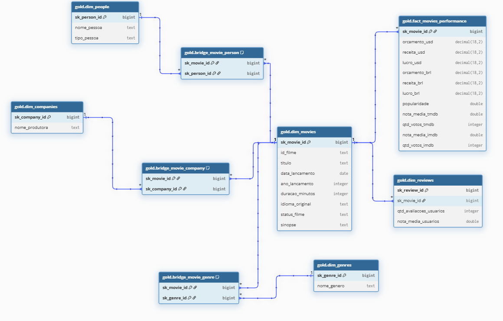
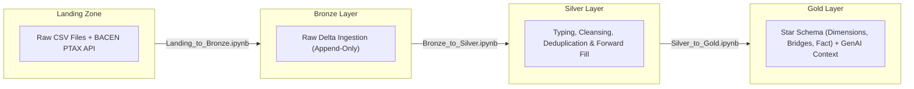
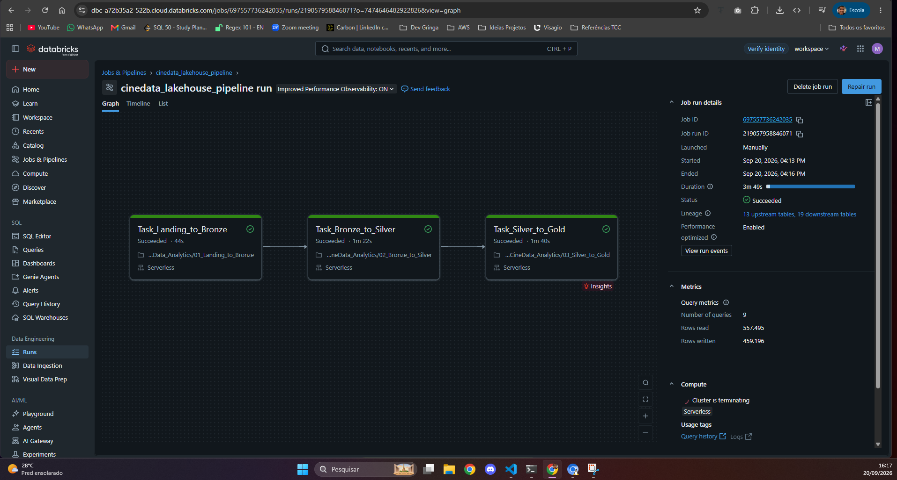
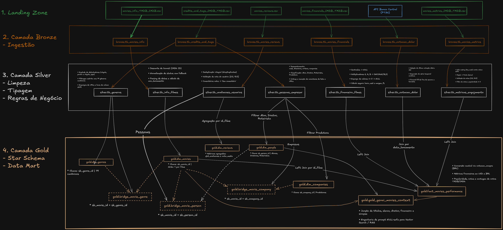

# CineData Analytics — Data Engineering & Lakehouse

<p align="left">
  
  
  
  
  
  
</p>

> **Part of the [CineRocket Platform](../README.md) Ecosystem**  
> An end-to-end Medallion Lakehouse pipeline (**Landing $\rightarrow$ Bronze $\rightarrow$ Silver $\rightarrow$ Gold**) engineered with PySpark on Databricks Serverless, covering raw ingestion, rigorous data cleansing/conformance, dimensional modeling (*Star Schema*), and Generative AI (RAG) context preparation.

---

## Table of Contents

- **1. [Business Analytics & Key Insights](#1-business-analytics--key-insights)**
  - [Question 1: Total Revenue in BRL](#question-1-what-is-the-total-revenue-in-brl-across-all-movies)
  - [Question 2: Top 5 Movies by Popularity](#question-2-what-are-the-top-5-movies-by-popularity)
  - [Question 3: Movie Count per Genre](#question-3-how-many-movies-per-genre-ranked-descending)
  - [Question 4: Top 10 Movies by Revenue using `RANK()`](#question-4-top-10-movies-by-revenue-with-rank)
  - [Question 5: Actor with Most Appearances in the Last 2 Years](#question-5-which-actor-had-the-most-appearances-in-movies-released-over-the-last-2-years)
  - [Question 6: Studio with Highest Profit in the Last 5 Years](#question-6-which-studio-generated-the-highest-cumulative-profit-over-the-last-5-years)
- **2. [Dimensional Modeling (Gold Layer)](#2-dimensional-modeling-gold-layer)**
  - [Fact and Dimensions (Star Schema)](#2-dimensional-modeling-gold-layer)
  - [GenAI Data Mart (`gold_genai_movies_context`)](#2-dimensional-modeling-gold-layer)
- **3. [Architecture and Pipeline Flow](#3-architecture-and-pipeline-flow)**
  - [Sources and Ingestion (Landing Zone + BACEN PTAX API)](#ingestion-sources-landing-zone)
  - [Processing Notebooks](#3-architecture-and-pipeline-flow):
    - Raw Ingestion: [Landing_to_Bronze.ipynb](notebooks/Landing_to_Bronze.ipynb)
    - Cleansing & Conformance: [Bronze_to_Silver.ipynb](notebooks/Bronze_to_Silver.ipynb)
    - Star Schema & GenAI Modeling: [Silver_to_Gold.ipynb](notebooks/Silver_to_Gold.ipynb)
- **4. [Workflow Execution on Databricks](#4-workflow-execution-and-orchestration)**
  - [Job Specification](job.yaml)
  - [Successful Execution Evidence](#4-workflow-execution-and-orchestration)
  - [Operational Scripts (`deploy_databricks.sh`, `run_job.sh`)](#operational-scripts-scripts)
- **5. [Lineage and Transformation Rules by Source](#5-detailed-lineage-and-transformation-rules-by-source)**
- **6. [Architecture Decision Records (ADR)](docs/ARCHITECTURAL_DECISIONS.md)**

---

## 1. Business Analytics & Key Insights

All analytical queries were executed against the **Gold** layer (`gold.fact_movies_performance` and associated dimensions):

### Question 1: What is the total revenue (in BRL) across all movies?
* **Result**: **R$ 837,762,389,824.54** (~ R$ 837.76 billion).
* **Exchange Rate Applied**: **R$ 5.1569** per US$ 1.00 (Central Bank of Brazil PTAX Buying Rate from 2026-09-18, sourced via Olinda API).
* **Spark Query**:
  ```python
  fact_movies_performance.select(
      spark_sum(col("receita_brl")).cast("decimal(18,2)").alias("receita_total_brl")
  ).show(truncate=False)
  ```

---

### Question 2: What are the top 5 movies by popularity?
| Rank | Movie Title | Popularity |
| :---: | :--- | :---: |
| 1st | blue beetle | 2994.357 |
| 2nd | Gran Turismo | 2680.593 |
| 3rd | The Nun II | 1692.778 |
| 4th | Meg 2: The Trench | 1567.273 |
| 5th | retribution | 1547.220 |

> **Engineering Note (*Column Shift* Neutralization)**: In the raw source file (`movies_metrics_IMDB_TMDB.csv`), unescaped commas shifted release years (`2020`, `2019`, `2018`) into the popularity metric column. The Silver layer neutralized this structural shift via `try_cast` and alphanumeric character filters, eliminating false positives and preserving metric integrity.

---

### Question 3: How many movies per genre? (Ranked descending)
| Rank | Canonical Genre | Movie Count |
| :---: | :--- | :---: |
| **1st** | Drama | 32,193 |
| **2nd** | Documentary | 18,946 |
| **3rd** | Comedy | 18,445 |
| **4th** | Thriller | 10,211 |
| **5th** | Horror | 9,590 |
| **6th** | Romance | 7,627 |
| **7th** | Action | 5,935 |
| **8th** | Crime | 4,710 |
| **9th** | Animation | 4,365 |
| **10th** | TV Movie | 4,072 |
| **11th** | Family | 3,718 |
| **12th** | Science Fiction | 3,695 |
| **13th** | Mystery | 3,274 |
| **14th** | Fantasy | 3,236 |
| **15th** | Adventure | 2,826 |
| **16th** | Music | 2,766 |
| **17th** | History | 2,400 |
| **18th** | War | 953 |
| **19th** | Western | 407 |

---

### Question 4: Top 10 movies by revenue with `RANK()`
| Rank | Movie Title | Revenue (US$) | Revenue (R$) |
| :---: | :--- | :---: | :---: |
| 1 | Avengers: Endgame | US$ 2,800,000,000.00 | R$ 14,439,320,000.00 |
| 2 | Avatar: The Way of Water | US$ 2,320,250,281.00 | R$ 11,965,298,674.09 |
| 3 | AVENGERS: INFINITY WAR | US$ 2,052,415,039.00 | R$ 10,584,099,114.62 |
| 4 | spider-man: no way home | US$ 1,921,847,111.00 | R$ 9,910,773,366.72 |
| 5 | The Lion King | US$ 1,663,075,401.00 | R$ 8,576,313,535.42 |
| 6 | Top Gun: Maverick | US$ 1,488,732,821.00 | R$ 7,677,246,284.61 |
| 7 | Barbie | US$ 1,428,545,028.00 | R$ 7,366,863,854.89 |
| 8 | The Super Mario Bros. Movie | US$ 1,355,725,263.00 | R$ 6,991,339,608.76 |
| 9 | Black Panther | US$ 1,349,926,083.00 | R$ 6,961,433,817.42 |
| 10 | Star Wars: The Last Jedi | US$ 1,332,698,830.00 | R$ 6,872,594,596.43 |

---

### Question 5: Which actor had the most appearances in movies released over the last 2 years?

* **Canonical Result (Post-Deduplication by Work / `tconst`)**:
  | Rank | Actor Name | Appearances in Released Films |
  | :---: | :--- | :---: |
  | **1st** | **Suhas** | **4 appearances** |
  | 2nd | Dean Cain | 3 appearances |
  | 3rd | Chris Spinelli | 3 appearances |
  | 4th | Eric Roberts | 3 appearances |
  | 5th | Goparaju Ramana | 3 appearances |

> **Technical Deep Dive & Catalog Anomaly Investigation**:
> * **The "Kevin Hart" Paradox (64 nominal appearances)**:
>   * In the raw dataset (`movies_info_TMDB_IMDB.csv`), the film *Die Hart 2: Die Harter* (IMDb ID `tt32094375`) appeared in **1,716 duplicated rows spread across 61 distinct numeric TMDB IDs** (`1300214`, `1362673`, etc.), all with the same release date (`2024-05-30`).
>   * Blind deduplication by technical key (`id`) retains all 61 records, artificially inflating Kevin Hart to **64 appearances** (59 replicas of *Die Hart 2* + 5 comedy specials).
>   * By enforcing **canonical deduplication by work in the Silver layer** — grouping primarily by the universal code `tconst` (IMDb) and prioritizing the most recent `ingestion_datetime` —, Kevin Hart is correctly restored to his actual **2 works released during the period**, purging analytical distortions.

---

### Question 6: Which studio generated the highest cumulative profit over the last 5 years?
| Rank | Studio / Production Company | Cumulative Profit (US$) |
| :---: | :--- | :---: |
| **1st** | **Universal Pictures** | **US$ 5,772,329,679.00** |
| 2nd | Marvel Studios | US$ 4,953,462,823.00 |
| 3rd | Columbia Pictures | US$ 3,662,050,755.00 |
| 4th | Pascal Pictures | US$ 2,701,952,454.00 |
| 5th | Illumination | US$ 2,431,353,473.00 |

---

## 2. Dimensional Modeling (Gold Layer)

The data architecture adheres to a formal dimensional **Star Schema** with bridge tables for M:N relationships, ensuring an atomic 1:1 grain in the performance fact table:



* **Fact Table**: `gold.fact_movies_performance` (Grain: 1 record per movie, containing budgets, revenues, profit in USD/BRL, and TMDB/IMDb audience metrics).
* **Dimensions**: `dim_movies`, `dim_genres`, `dim_people`, `dim_companies`, `dim_reviews`.
* **Bridge Tables**: `bridge_movie_genre`, `bridge_movie_person`, `bridge_movie_company`.
* **GenAI Context Data Mart**: `gold_genai_movies_context` (Enriched, null-safe textual document designed for semantic search and vector indexing / RAG).

---

## 3. Architecture and Pipeline Flow

Data is processed end-to-end across modular stages:



### Ingestion Sources (Landing Zone)
1. **`movies_info_TMDB_IMDB.csv`**: General metadata (title, overview, release date, runtime, language, status).
2. **`movies_financials_IMDB_TMDB.csv`**: Box office and budget metrics (US$).
3. **`movies_metrics_IMDB_TMDB.csv`**: Ratings and vote metrics from TMDB and IMDb.
4. **`credits_and_tags_IMDB_TMDB.csv`**: Cast, directors, writers, genres, and studios.
5. **`movies_reviews.csv`**: User reviews and textual comments.
6. **Central Bank of Brazil (PTAX API)**: Daily USD/BRL commercial exchange rate via BACEN Olinda API, applying continuous *Forward Fill* across weekends and holidays.

---

## 4. Workflow Execution and Orchestration

The pipeline is orchestrated on **Databricks Workflows** using **Serverless Compute**, running successfully end-to-end:



### Operational Scripts (`scripts/`)
* **Deploy to Databricks**: `./scripts/deploy_databricks.sh` (syncs workspace notebooks and resets job definitions via `job.yaml`).
* **Run & Monitor**: `./scripts/run_job.sh` (triggers execution via Databricks CLI and streams logs in real-time).
* **Local Setup**: `./setup.sh` (configures local virtual environment and dependencies using `uv`).

---

## 5. Detailed Lineage and Transformation Rules by Source

The following lineage diagram details the lifecycle of each raw file, conformance transformations in the **Silver** layer, and dimensional joins consolidated in the **Gold** layer:


